<!-- Header -->

  

  

  <a href="https://abhinavgonthina.dev"><b>🌐 Portfolio</b></a> &nbsp;·&nbsp;
  <a href="https://linkedin.com/in/abhinavgonthina"><b>💼 LinkedIn</b></a> &nbsp;·&nbsp;
  <a href="mailto:gonthina.a@northeastern.edu"><b>✉️ Email</b></a>

 

<table align="center">
  <tr>
    <td align="center">
       
      I care about building systems that balance <b>innovation</b> with <b>resilience</b>. I like getting something real out early, but then will circle back to it until I'm genuinely proud of how it works and its fault tolerance.
        
    </td>
  </tr>
</table>

 

<h2>
  <picture>
    <source media="(prefers-color-scheme: dark)" srcset="assets/h-where-dark.svg" />
    
  </picture>
</h2>

|     | Role                                                 | What I worked on                                                                                                                                                     |
| :-: | :--------------------------------------------------- | :------------------------------------------------------------------------------------------------------------------------------------------------------------------- |
| 🏥  | **Athenahealth** · SWE Intern · _Summer '26_         | Worked on cloud infrastructure: set up **autoscaling** for our services, built an internal **data store app**, and put together the team's **monitoring dashboard**. |
| 🩺  | **Philips** · SWE Co-op · _Spring '26_               | Built features for a **medical device simulator** and UI for the **PIC iX** patient monitoring platform, and hunted down bugs across the stack.                      |
| ✈️  | **Quak Travel** · SWE Intern · _'25 – '26_           | Early engineer at a travel startup. I built **group hotel booking** with split payments and the **mobile itinerary and expense** views, and sped up the backend.     |
| 🏎️  | **Northeastern Electric Racing** · SWE · _'25 – '26_ | Worked on **FinishLine**, the team's project tracker, adding UI features and a **rules PDF parser**.                                                                 |
| 🌧️  | **Rainfall Learning** · Tech Lead · _Summer '25_     | Led the **payments team** for a tutoring platform, building out Stripe checkout and tutor payouts.                                                                   |

 

<h2>
  <picture>
    <source media="(prefers-color-scheme: dark)" srcset="assets/h-stack-dark.svg" />
    
  </picture>
</h2>

  
   
  

 

<h2>
  <picture>
    <source media="(prefers-color-scheme: dark)" srcset="assets/h-made-dark.svg" />
    
  </picture>
</h2>

<table>
  <tr>
    <td width="50%" valign="middle" align="center">
      <h3>📊 <a href="https://ontrack.abhinavgonthina.dev">OnTrack</a></h3>
      <code>Next.js</code> <code>Spring Boot</code> <code>PostgreSQL</code> <code>Gemini</code>
      
A job tracker that turns your whole interview pipeline into a <b>Sankey diagram</b>. It also scores your resume against a job description with AI and enforces three tiers of rate limiting.

       
    </td>
    <td width="50%" valign="middle" align="center">
      <h3>🤝 CoDesign</h3>
      <code>React</code> <code>Tailwind</code>
      
A social platform for designers and developers with posts, messaging, and matchmaking. Demoed to <b>100+ people</b> at Northeastern's Oasis Day.

       
    </td>
  </tr>
  <tr>
    <td width="50%" valign="middle" align="center">
      <h3>✈️ Quak Travel</h3>
      <code>React Native</code> <code>Express</code> <code>Stripe</code> <code>Redis</code>
      
A group travel app where I built <b>hotel booking with split payments</b>, itinerary and expense views, and a caching layer to speed up search.

       
    </td>
    <td width="50%" valign="middle" align="center">
      <h3>🏁 FinishLine</h3>
      <code>React</code> <code>Express</code> <code>Prisma</code>
      
NER's project management system, which I extended with a <b>parts review</b> flow, <b>rules PDF parsing</b>, and <b>Gantt chart</b> features.

       
    </td>
  </tr>
</table>

 

<h2>
  <picture>
    <source media="(prefers-color-scheme: dark)" srcset="assets/h-into-dark.svg" />
    
  </picture>
</h2>

<table>
  <tr>
    <td width="33%" valign="middle" align="center">
      <h3>🏗️</h3>
      <b>System Design</b>
      
Seeing how every piece fits at a high level is how I know the whole thing actually works.

       
    </td>
    <td width="33%" valign="middle" align="center">
      <h3>✨</h3>
      <b>Features People Love</b>
      
The intricate, detail-heavy work that makes someone's day noticeably easier.

       
    </td>
    <td width="33%" valign="middle" align="center">
      <h3>🎓</h3>
      <b>Breaking It Down</b>
      
Turning complex ideas into simple ones, whether for a teammate, a team I'm leading, or a student.

       
    </td>
  </tr>
</table>

<!-- Footer -->

  

